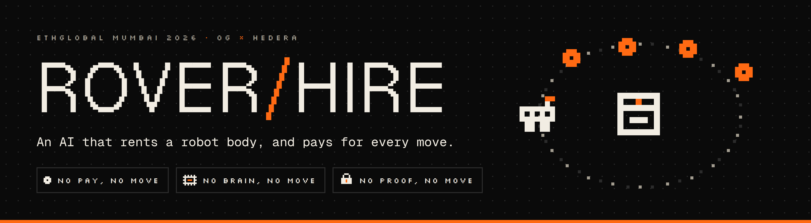
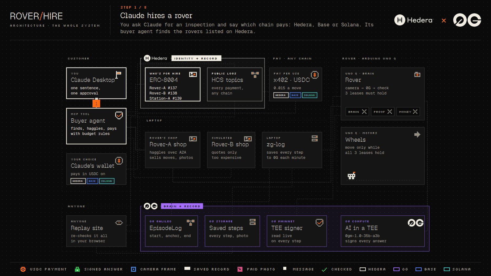

# Rover for Hire

Claude can think, but it has no wheels and no eyes. So it rents some.

You type one sentence into Claude: *"Inspect parcel #3 and send me 5 photos. Spend at most 0.80 USDC."* Claude finds a small robot car listed on Hedera, agrees a price with it, and hires it. The rover drives around the room, finds the box marked #3 among look-alike boxes, and photographs it from every side. Each photo shows up in your chat a few seconds after it is taken.

Built for **ETHGlobal Mumbai 2026**, for 0G's *Physical AI: Agents with a Body* and Hedera's *AI Agents That Pay: x402 on Hedera*.

## Three rules for every move

| Rule | What it means |
|---|---|
| **No&nbsp;pay,&nbsp;no&nbsp;move** | Claude pays for each move in USDC *before* the wheels turn, on the chain you choose: Hedera, Base or Solana. |
| **No&nbsp;brain,&nbsp;no&nbsp;move** | An AI model on 0G looks at the camera and picks each move. The rover never makes up a move by itself. |
| **No&nbsp;proof,&nbsp;no&nbsp;move** | The model's answer is signed inside 0G's sealed hardware (a TEE). The rover checks that signature before it moves. |

If any rule fails, the wheels stay still and the rover's LED face shows why: `402` (not paid yet), `0G?` (no answer), `!TEE` (bad signature), `BAT` (battery low) or `STOP` (something close in front).

## How a mission goes

1. **Find.** Claude's buyer agent looks up the rovers listed in the ERC-8004 registry on Hedera.
2. **Haggle.** Claude first asks you which chain to pay on: Hedera, Base or Solana. Then the buyer agent asks each rover's shop for a price over A2A, and hires the best offer that fits the budget from a rover that takes USDC on that chain.
3. **Look around.** The rover turns and takes pictures. The 0G model reads the number on each box, and the rover turns to face the right one.
4. **Drive, one step at a time.** For every move, the rover sends its camera picture to 0G and gets back one signed move. It checks the signature and the payment, and only then drives.
5. **Double-check the box.** Before each photo, the rover asks 0G a second, blind question: *"what number is on this box?"* If it is not the right one, there is no photo and no charge.
6. **Deliver.** Each photo is paid when it arrives, and it appears in the chat.
7. **Write it all down.** Every step (picture, question, answer, signature, payment) is saved to 0G Storage and fixed on 0G's chain. At the end, Claude leaves the rover a review on Hedera.

## The whole system

More pictures: [the Hedera part](docs/rover/media/rover-hire-hedera.gif) · [the 0G part](docs/rover/media/rover-hire-0g.gif) · [paying on Hedera, Base or Solana](docs/rover/media/rover-hire-multichain.gif) · [the slides](docs/rover/media/rover-hire-deck.pdf)

| | What we use it for |
|---|---|
| **Hedera** | **x402** for paying each move and photo in USDC · **HCS topics** as public logs of money and spending · **ERC-8004** for listing the rovers and reviewing them · **A2A** for haggling · **Hedera Agent Kit** as the buyer's toolbox |
| **0G** | **0G Compute** runs the model in a TEE and signs every answer · **0G Storage** keeps every step and photo · **EpisodeLog** on 0G Galileo fixes each mission's record on chain |

**Pay on Hedera, Base or Solana.** The rover and the station also take USDC on Base Sepolia and Solana devnet, and you pick the chain for every mission and every reading. Your AI asks you each time; it never picks for you. A seller's address on each chain is written on its ERC-8004 card *and* in its shop, and the buyer pays only an address that both name. Only testnets are allowed, on both sides. Whichever chain pays, the payment is written down on Hedera too, on the seller's HCS topic. ([how it fits together](https://rover-replay.vercel.app/architecture/multichain/))

## Check it yourself

Open **https://rover-replay.vercel.app** and pick a mission. Your browser re-checks every 0G record, every TEE signature and every payment (on Hedera, Base or Solana, wherever it was paid), from public data only. No server of ours sits in between.

| Proof | Where |
|---|---|
| A move, paid with x402 on Hedera before the rover drove (**README tx id**) | [`0.0.7162784@1793968605.720553402`](https://hashscan.io/testnet/transaction/1793968611.273596433): 0.015 USDC from the buyer `0.0.11326806` to Rover-A `0.0.11327287`, the first move of mission `a-7c7666ae` at the event (3 of 3 photos, 0.465 USDC) |
| The same, paid on Solana devnet | [`32S5151q…Gia2GzFL`](https://explorer.solana.com/tx/32S5151qXYrwe2Qr4kjnPQaANLYYVExuvgZr1Vjo3r1UFKygRJMoQPhqYPijbBUoD5MtjUne1HteAceQgia2GzFL?cluster=devnet): the first move of mission `a-1d5f5382` (1 of 1 photo), recorded on Rover-A's Hedera money topic with its Solana transaction |
| The mission log contract on 0G Galileo | EpisodeLog [`0x44152879…fd3B3E7`](https://chainscan-galileo.0g.ai/address/0x44152879e809A63F70d4c529826660a65fd3B3E7) |
| The 0G TEE key that signs every answer | read live from 0G's mainnet contract for provider `0xf4FB8d2b…0079B250`, on every step |
| The rover on ERC-8004 | Rover-A is agent **#137** |

Every other id is in [docs/rover/IDS.md](docs/rover/IDS.md).

## Hire it from your own AI

The rover's tools speak MCP, so any AI app that supports MCP can hire it, not only the owner's Claude Desktop.

- **On the owner's laptop:** Claude Desktop runs our MCP server locally (see *Run it* below).
- **From anywhere:** a remote MCP server runs at **`https://rover-for-hire.onrender.com/mcp/<your key>`**. Add that address as a custom connector:
  - in **Claude**: Settings → Connectors → *Add custom connector*;
  - in **ChatGPT**: turn on Developer mode, create a connector, and choose *No authentication*. The key is already in the address.

  Then ask it to *"Hire a rover to inspect parcel #1, 3 photos, budget 0.60 USDC"*. Each user needs a key: ask us for one (judges get one).

**How it stays safe when strangers can hire it:**

- **Only the MCP server lives in the cloud.** The rover's shop, the 0G logger and the rover itself stay together on the booth's Wi-Fi. The heartbeat that keeps a paid move alive never crosses the internet.
- **The cloud reaches the shop through a tunnel with a filter in front.** Only the shop's public routes get through. Starting or ending a mission needs a secret key, the 0G logger is read-only, and everything else gets "not found".
- **Remote missions pay from their own wallet** (Hedera `0.0.11328337`, Base `0xdBBe01AA5b82745dEd88eE1bD10AaeC38eb6A2a6`, Solana `5GvKsCVADiqsxu7G1xFoujU2BT7Ahf371ZefwchAkpno`), never the owner's. One mission can spend at most 1 USDC, and all remote users together at most 2 USDC a day. A mission's unused budget is freed when it ends.
- **The owner has one switch.** The *Rover: remote access* button on the laptop (`scripts/p13/mode.sh hybrid | local`) turns remote hiring on or off. When it's off, or the laptop is gone, remote users see the rover as offline within about 3 minutes.
- **A user only sees their own missions,** and the rover takes one mission at a time. A second hire gets "rover busy" before anything is paid.

## A second body: the sensor station

The marketplace is not only for rovers. **Station-A** is a second Arduino UNO Q with a climate sensor (AHT20 + BMP280), a light sensor and a motion sensor. It sells what it measures, through the same Hedera path the rover uses.

- **Found on-chain.** Station-A is ERC-8004 agent **#139**. Its card lists its prices and the address that signs its readings.
- **Paid per reading with x402, on the chain you choose.** A reading costs 0.001 USDC, a motion count 0.0005 USDC, and history 0.0002 USDC per minute (1 to 60 minutes), in USDC on Hedera, Base Sepolia or Solana devnet. Its card lists where it takes payment, and every sale still goes on its Hedera topic, whichever chain paid. The payment settles only after the data is delivered, so a failed read costs nothing.
- **Signed on the station.** The station signs every reading with its own key. The buyer checks that signature, and refuses a reading that is more than 10 s old, not newer than the last one it saw, or physically impossible.
- **Logged on Hedera.** Every sale goes to the station's HCS topic `0.0.11328274`, with a hash of the exact data that was sold.
- **Ask your AI.** Both MCP servers, the local one and the remote one, have `find_sensors`, `buy_sensor_reading` and `buy_sensor_history`. Ask *"What's the temperature and humidity at the station right now? Pay with Base."* The answer comes with a receipt: the values, then a link behind every proof.

Before the event, we tested it with the real station: 600 of 600 reads in 10 minutes with no sensor errors, paid buys from the command line and from ChatGPT Desktop, no charge when the station was switched off, refusals before paying when the price was changed, half an hour on a wall charger (30 of 30 readings paid and verified), a sensor wire pulled out (no reading sold, and it recovered by itself), and breath, light and motion checks by hand. The records are in [prior-work/evidence/P12](prior-work/evidence/P12).

## What is in this repo

| Folder | What it does |
|---|---|
| `rover/` | The rover's brain on the Arduino UNO Q: camera, mission rules, 0G calls, signature checks (Python) |
| `firmware/rover_mcu` | The rover's reflexes: motors, sonar, battery, LED face. It stops the wheels if the brain goes quiet |
| `packages/hedera-buyer` | Claude's buyer agent: it finds rovers, haggles, pays and leaves reviews |
| `services/hedera-shop` | The shops, each behind an x402 payment wall: the rovers' (prices, haggling) and Station-A's (`src/station.ts`) |
| `services/mcp-server` | The tools an AI uses: `find_rovers`, `hire_rover`, `rover_mission_status`, `end_rover_mission`, and the three sensor tools. Runs locally for Claude Desktop, and as the remote server on Render (`src/http.ts`) |
| `station/` | Station-A's service on its UNO Q: reads the sensors once a second, signs every reading, serves them on the Wi-Fi (Python) |
| `firmware/station_mcu` | Station-A's sensor code on the board's microcontroller: climate, light and motion |
| `scripts/p13` | The remote access switch (`mode.sh`), the filter in front of the shops (`edge/`) and the tunnel setup |
| `services/zg-log` | Saves every step to 0G Storage and fixes it on the EpisodeLog contract |
| `contracts/episode-log` | `EpisodeLog.sol`, on 0G Galileo |
| `apps/replay` | The public replay site. Every check runs in your browser |
| `apps/hud` | The live screen for a demo |

## Run it

You need the rover ([HARDWARE_PREP.md](HARDWARE_PREP.md)), a laptop on the same Wi-Fi, Node 24, pnpm 10, Claude Desktop, a Hedera testnet account with USDC and HBAR, a Galileo wallet with test 0G, and a 0G API key.

1. **Build.** `pnpm install`, then `pnpm --filter "@0xBs/zg-log..." --filter "@0xBs/hedera-shop..." --filter "@0xbBs/mcp-server..." --filter replay --filter hud run build`.
2. **Fill in the env files.** They are gitignored, and their values are never printed. The names are below.
3. **Set up the rover.** From the laptop, run `rover/tools/deploy.sh --flash`. Then, on the board, run `sudo ~/0xbs-rover/rover/tools/install_services.sh` once.
4. **Start the laptop side.** Run `scripts/laptop/install.sh` once. It starts zg-log, the three shops (Rover-A, Rover-B, Station-A), the HUD and a local replay site as services that come back by themselves after a crash or a reboot.
5. **Connect Claude.** Add `services/mcp-server/dist/index.js` to Claude Desktop as an MCP server.
6. **Check everything.** `node scripts/event-check.mjs` checks 0G, Hedera, the laptop services and the rover, and says what to fix.
7. **Hire the rover.** Ask Claude: *"Hire a rover to inspect parcel #3, 5 photos, budget 0.80 USDC."* Watch it live on the HUD at http://127.0.0.1:8080.

The env file names

- board `~/0xbs-rover/rover.env`: `ZG_API_KEY`, `ROVER_LAN_TOKEN`, `ZG_LOG_URL`, `ZG_LOG_TOKEN`, `CAMERA_DEVICE`, `ROVER_PORT`, `ROVER_TEST_MODE` (off for demos)
- `services/zg-log/.env`: `ZG_PRIVATE_KEY`, `EPISODE_LOG_ADDRESS`, `ZG_LOG_TOKEN`, `PORT`, `SEGMENT_S`
- `services/hedera-shop/.env.a`: `HEDERA_ROVER_ID`, `HEDERA_ROVER_KEY`, `HCS_MONEY_TOPIC`, `ROVER_URL`, `ROVER_LAN_TOKEN`, `PORT`, `PUBLIC_URL`, `SHOP_NAME`, `ERC8004_AGENT_ID`, the prices and price floors (`.env.b` is the same for Rover-B, without a rover)
- `packages/hedera-buyer/.env`: `HEDERA_BUYER_ID`, `HEDERA_BUYER_KEY`, `HCS_SPEND_TOPIC`, `AUDIT_TOPIC`, `ERC8004_FROM`
- `services/hedera-shop/.env.s` (Station-A): `HEDERA_STATION_ID`, `HEDERA_STATION_KEY`, `HCS_SALES_TOPIC`, `STATION_URL`, `STATION_LAN_TOKEN`, `STATION_SIGNER`, `ERC8004_AGENT_ID`, `PORT`, the prices
- station board `~/0xbs-station/station.env`: `STATION_PRIVATE_KEY`, `STATION_LAN_TOKEN`

## Honest notes

- **Rover-B is simulated.** It is a real shop with its own Hedera account and ERC-8004 entry, and it really quotes and haggles, but there is no second robot behind it.
- **Networks.** Payments run on Hedera testnet with testnet USDC. Records go to 0G's Galileo testnet. The AI model runs on 0G mainnet.
- **The TEE.** The rover checks every answer's signature against 0G's on-chain record. 0G's own `pcverify` confirms that the signing key lives in genuine Intel TDX hardware, but it also reports that the provider runs older serving software than 0G's accepted release.
- **Simple hardware.** The rover has no wheel encoders yet, so distances are timed and checked with the sonar, which only faces forward.
- **A weak network slows remote missions.** With 300 ms of extra delay, a 3-photo mission still finished. At 800 ms and 5 % packet loss, each payment took about 8 s and the mission hit its 6-minute limit with 1 photo. It still stopped safely, with every move paid before it ran and the full record kept.
- **Station-A's limits.** Its light value is a relative level from an uncalibrated light sensor, not lux. The pressure part of its BMP280 is faulty (stuck at full scale), so it sells no pressure; that chip's temperature still cross-checks the AHT20. And 0.001 USDC per reading is a testnet demo price: on mainnet, the fee for each payment (about 0.014 HBAR) would cost more than the reading itself, so history bundles are the realistic product.

Others have joined robots and payments before: [Paybot](https://ethglobal.com/showcase/paybot-q7grd), [Hands Unchained](https://ethglobal.com/showcase/hands-unchained-6kdf3) and [RTP](https://dev.to/mr_hamlin/introducing-rtp-how-ai-agents-will-hire-robots-with-a-single-http-request-d3d). Here, the AI does the driving, every move is paid and proven before it happens, and anyone can re-check the whole mission from public chains.
